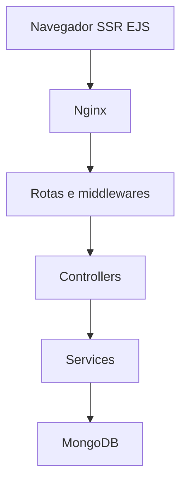

# Projeto Profissional

[](https://github.com/pedroiff0/projeto-profissional/actions/workflows/ci.yml) [](LICENSE) [](https://github.com/pedroiff0/projeto-profissional/stargazers) [](#roadmap)

Template base para aplicações web completas: autenticação JWT, papéis `admin` e `user`, validação com Zod, renderização no servidor com EJS, Docker Compose para desenvolvimento e produção e testes Jest em memória.

Este projeto faz parte do [portfólio](https://portfolio.phrandrade.com/#projeto-profissional) de Pedro Rocha.

## Sumário

- [O que é](#o-que-é)
- [Tecnologias](#tecnologias)
- [Começando](#começando)
- [Como usar](#como-usar)
- [Configuração](#configuração)
- [Implantação](#implantação)
- [Arquitetura](#arquitetura)
- [Trabalhando no projeto](#trabalhando-no-projeto)
- [Roadmap](#roadmap)
- [Suporte](#suporte)
- [Segurança](#segurança)
- [Contribuindo](#contribuindo)
- [Estrelas e atividade](#estrelas-e-atividade)
- [Autor](#autor)
- [Licença](#licença)

## O que é

O Projeto Profissional resolve o início repetitivo de aplicações web para quem precisa de login, papéis e painel prontos e seguros. Ele entrega a estrutura em camadas, a configuração de segurança e a infraestrutura de contêineres. Não traz regras de negócio de nenhum domínio.

### Funcionalidades

- Autenticação com JWT em cookie `httpOnly`, controle de papéis e limite de requisições.
- Validação estrita de entrada com Zod e cabeçalhos de segurança com Helmet (compatível com CSP).
- Renderização SSR em EJS, sem etapa de build, com tema claro e escuro.
- Docker Compose com perfis de desenvolvimento e produção e segredos isolados.
- Suíte Jest com Supertest e `mongodb-memory-server`.

## Tecnologias

      

## Começando

### Pré-requisitos

- Node.js 22 LTS e npm.
- Docker e Docker Compose.
- `make`.

### Instalação

```bash
gh repo create meu-novo-app --template pedroiff0/projeto-profissional --private --clone
cd meu-novo-app/app && npm install
```

Sem o GitHub CLI: clone o repositório, entre na pasta e rode `git remote remove origin`.

### Primeira execução

```bash
make dev
```

### Conferindo que funcionou

```bash
make health
```

Saída esperada: status HTTP 200 na porta de desenvolvimento (4429).

## Como usar

### Tarefa 1: rodar os testes

1. `cd app && npm test`.
2. Confirme que todas as suítes passam.

### Tarefa 2: subir a produção local

1. Configure os segredos conforme [Configuração](#configuração).
2. Rode `make prod`.
3. Confira com `make health` (porta 4430).

### Comandos disponíveis

| Comando | Descrição |
| :--- | :--- |
| `make dev` | Stack local com live-reload na porta 4429 |
| `make down` | Para e remove os contêineres de desenvolvimento |
| `make test` | Suíte Jest em memória |
| `make lint` | Linter e verificação de sintaxe |
| `make prod` | Stack de produção na porta 4430 |
| `make health` | Saúde e status HTTP das portas |

## Configuração

| Variável | Padrão | Para que serve |
| :--- | :--- | :--- |
| `MONGO_URI` | contêiner `mongo` do Compose | Conexão com o banco |
| `JWT_SECRET` | sem padrão | Assinatura dos tokens |
| `PORT` | `4429` (dev) e `4430` (prod) | Porta HTTP |

Valores sensíveis ficam em `.env` (nunca no Git); o modelo está em `.env.example`.

## Implantação

### Com Docker Compose

```bash
make prod
```

### Atualizando

```bash
git pull
make prod
```

### Desfazendo uma atualização

```bash
git checkout <tag-anterior>
make prod
```

### Backup e restauração

Faça o dump do volume do MongoDB (`mongodump`) antes de atualizar e restaure com `mongorestore`.

## Arquitetura

Camadas desacopladas: rotas e middlewares, controllers (tradução HTTP), services (regras de negócio) e models Mongoose.



## Trabalhando no projeto

```bash
cd app && npm install
make test
make lint
```

1. Crie uma branch a partir de `main`: `git checkout -b feat/<assunto-curto>`.
2. Commits no padrão [Conventional Commits](https://www.conventionalcommits.org/pt-br/).
3. Rode `make test` e `make lint` antes de abrir o pull request.
4. Registre a mudança na seção `Unreleased` de [CHANGELOG.md](CHANGELOG.md).

## Roadmap

- [x] Autenticação, papéis e validação
- [x] Compose de desenvolvimento e produção
- [ ] Recuperação de senha por e-mail
- [ ] Exemplo de módulo de domínio completo

## Suporte

Veja [SUPPORT.md](SUPPORT.md).

## Segurança

Veja [SECURITY.md](SECURITY.md) para reportar vulnerabilidades de forma confidencial.

## Contribuindo

Veja [CONTRIBUTING.md](CONTRIBUTING.md) e [CODE_OF_CONDUCT.md](CODE_OF_CONDUCT.md).

## Estrelas e atividade

[](https://star-history.com/#pedroiff0/projeto-profissional&Date)

[](https://github.com/pedroiff0/projeto-profissional/graphs/commit-activity) [](https://github.com/pedroiff0/projeto-profissional/commits) [](https://github.com/pedroiff0/projeto-profissional/issues) [](https://github.com/pedroiff0/projeto-profissional/pulls)

## Autor

<table>
  <tr>
    <td align="center"><a href="https://github.com/pedroiff0"><br /><sub><b>Pedro Henrique Rocha de Andrade</b></sub></a><br />Autor e mantenedor</td>
  </tr>
</table>

### Contribuidores

[](https://github.com/pedroiff0/projeto-profissional/graphs/contributors)

## Licença

MIT. Veja [LICENSE](LICENSE).

Pedro Henrique Rocha de Andrade, 2026.
